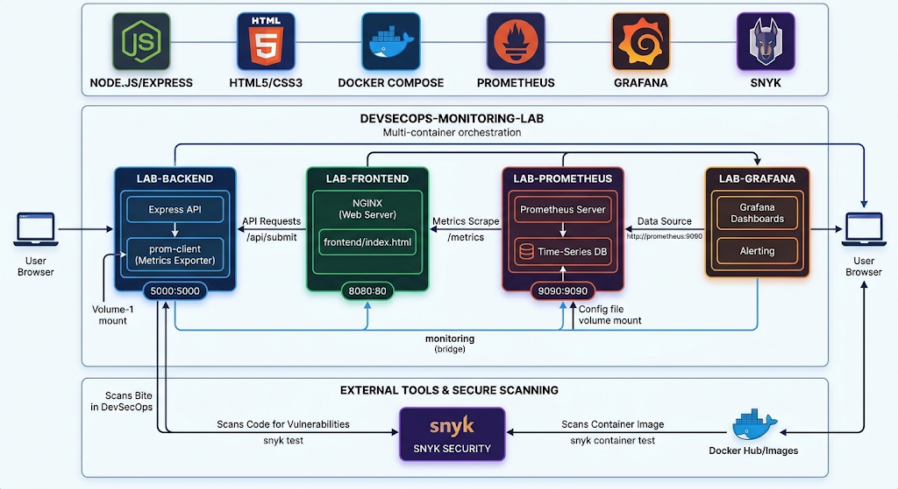

## Introduction to DevOps: DevSecOps Monitoring and Logging Lab

## App Architecture:



## Objective:
- Monitor system and pipeline-level metrics using Prometheus and Grafana
- Scan code for vulnerabilities using SonarQube or Snyk
- Reflect on the importance of DevSecOps and observability in CI/CD


## Individual docker run commands:
```bash
docker network create monitoring
```

```bash
docker run -d \
  --name=node-exporter \
  --network=monitoring \
  -p 9100:9100 \
  prom/node-exporter
```

```bash
docker run -d \
  --name=prometheus \
  --network=monitoring \
  -p 9090:9090 \
  -v $PWD/prometheus.yml:/etc/prometheus/prometheus.yml \
  prom/prometheus
```

```bash
docker run -d \
  --name=grafana \
  --network=monitoring \
  -p 3000:3000 \
  grafana/grafana
```